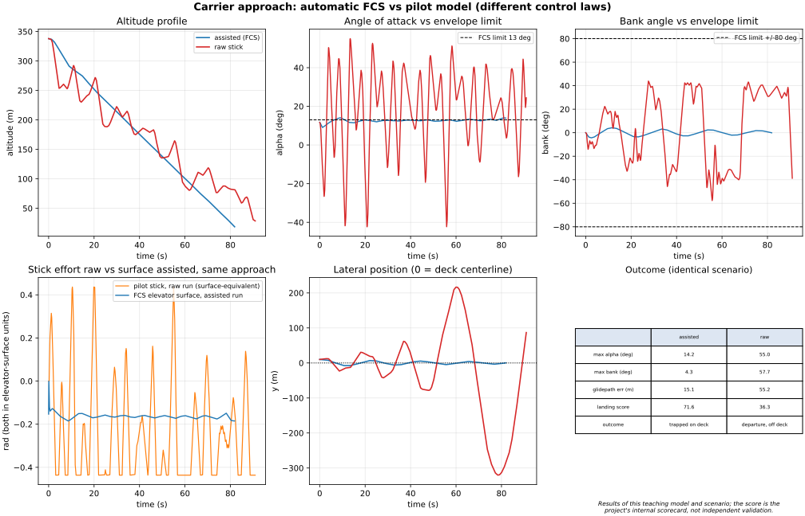
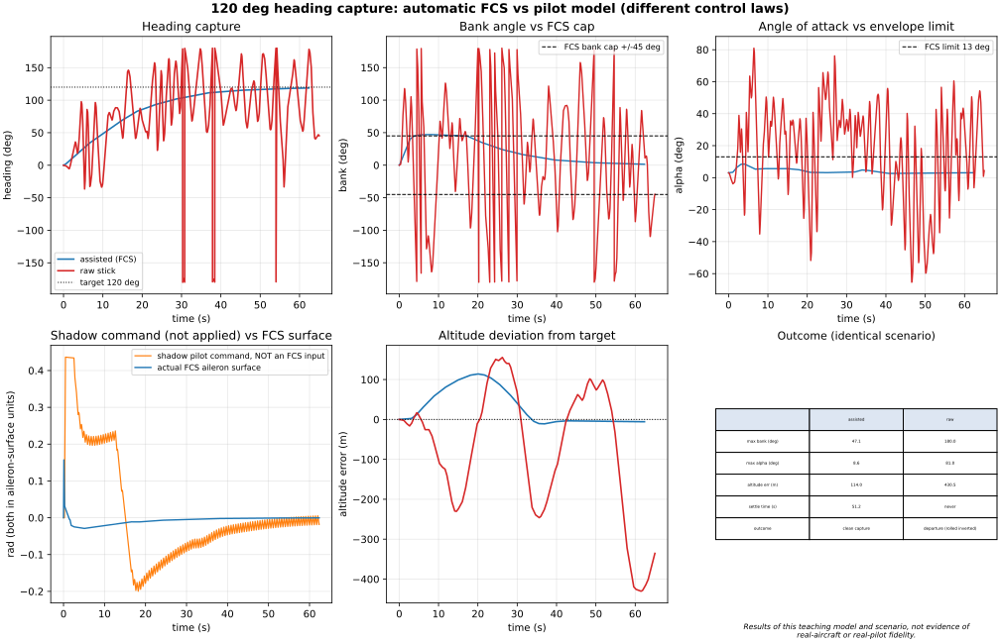
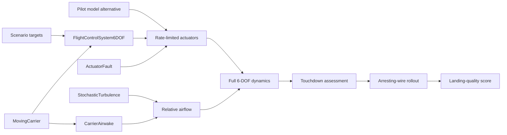

# Flight Control Lab

An educational Python simulator for fighter-like flight-control assistance: protected manoeuvres, takeoff guidance, and automatic corrections for an approach to a moving aircraft carrier.

**Scope and honesty.** This is a generic teaching model, not real military avionics, not a certified flight-control system, and not a digital twin of any operational aircraft. The parameters are plausible classroom values chosen to make the control ideas visible and testable.

## Current implementation

- Nonlinear full 6-DOF rigid-body dynamics in NED coordinates.
- Quaternion attitude propagation with RK4 integration.
- Stability-derivative aerodynamics: lift, induced/profile drag, sideslip, roll, pitch and yaw moments.
- Throttle, elevator, aileron and rudder with rate and position limits.
- Layered flight-control system:
  - autothrottle;
  - altitude and vertical-speed guidance;
  - heading/bank capture;
  - pitch, roll and yaw damping;
  - angle-of-attack, sideslip, bank and load-factor protection;
  - carrier-approach flare correction.
- Takeoff scenario with ground-roll acceleration, rotation and altitude capture.
- Manoeuvre-assist scenario with a protected 120-degree heading capture.
- Moving carrier with forward motion plus sinusoidal heave, pitch and roll.
- Deterministic carrier airwake: localized headwind deficit, downwash/burble and light crosswind disturbance behind the ship.
- Moving-deck touchdown scoring: deck window, line-up, relative speed, relative sink rate and deck-motion limits.
- Four-wire arresting and rollout scoring: wire number, capture window, cable payout, stop distance, remaining-deck margin, deck roll during rollout and a 0-100 score.
- Harder carrier scenarios: rough seas, larger initial offset recovery, stronger airwake, seeded stochastic turbulence and an aileron-effectiveness fault.
- Transparent landing-quality scorecard combining sink, line-up, glidepath, speed and arrestment performance.
- Scripted cobra demonstration on a flat-plate post-stall teaching extension: pull, float past 90 deg of angle of attack, scripted push, then the standard FCS recovers level flight.
- Deterministic imperfect pilot model: reaction delay, PD error chase, weak rate sense, trim integrator and tremor - but no envelope awareness.
- Controller comparison: automatic FCS guidance versus an imperfect pilot model, with the same target, initial state and disturbances.
- A simpler 3-DOF point-mass baseline is kept for comparison and teaching.
- Static diagnostic preview renderer and an animated carrier-approach GIF renderer.
- 3D visualization: perspective and deck close-up stills plus animated 3D views; the carrier is drawn as a ship (hull, island, deck markings, wires following heave/pitch/roll) and the aircraft as a Rafale-inspired delta-canard glyph showing its true attitude.

## Pilot assistance comparison

The question this project answers: what does the flight-control system actually do for the pilot?

Two alternative controllers fly the same moving-carrier approach: same ship motion, same burble, same initial state.

- **assisted** (legacy CLI label): automatic FCS guidance tracks scenario targets and commands the surfaces.
- **raw**: an imperfect pilot model tracks the same task and commands the surfaces directly.

The FCS does **not** receive or filter the pilot model's stick. This is a controller comparison, not an ablation of a shared pilot-in-the-loop assistance layer. Differences include guidance law, gains, damping and protection; the results cannot isolate the benefit of any one feature.

| Metric | Assisted | Raw stick |
| --- | --- | --- |
| Max angle of attack (deg) | 14.2 | 55.0 |
| Max bank (deg) | 4.3 | 57.7 |
| Max glidepath error (m) | 15.1 | 55.2 |
| Landing score (0-100) | 71.6 | 36.3 |
| Outcome | trapped on deck | departure, misses the deck |

These numbers describe this teaching model and this scenario only. The landing score is the project's internal scorecard, not an independent validation, and the comparison demonstrates how the assistance layer behaves - it is not evidence of real-aircraft fidelity.



The bottom-left panel compares commands from separate runs, not an input/output transfer through the FCS. The delayed pilot model oscillates and saturates; the automatic controller gives a smoother response in this scenario. The alpha limiter targets 13 deg but is not a hard bound: dynamics and rate-limited actuators allow overshoot (14.2 deg peak here).

The pilot is deliberately limited and not calibrated against human data. Its poor performance is not evidence about trained pilots. Excursions into high-alpha flight are outside the model's validated domain: their exact peaks are numerical outputs, not reliable predictions of real departures.

```bash
python3 compare_assistance.py          # writes the comparison figure
python3 run_scenario.py assist-compare # prints the metrics
```

### Manoeuvre assistance: 120-degree heading capture

The same controller comparison on a 120-degree heading capture: automatic FCS guidance versus an aggressive, delayed pilot model without load or bank awareness.

| Metric | Assisted | Raw stick |
| --- | --- | --- |
| Max bank (deg) | 47.1 | 180.0 |
| Max angle of attack (deg) | 8.6 | 81.0 |
| Max altitude deviation (m) | 114.0 | 430.5 |
| Heading overshoot (deg) | 0.0 | 65.8 |
| Settle time (s) | 51.2 | never settled |
| Outcome | clean capture | departure (rolled inverted) |



The orange trace is a shadow pilot's hypothetical command evaluated on the FCS trajectory. It is recorded only and never applied or passed into the FCS. The blue trace is the actual FCS aileron surface. The bank target is capped at 45 deg, with a 47.1 deg observed peak; this is not a hard attitude bound. Altitude error still reaches 114 m, so the automatic controller has visible room for improvement.

The `lost_control` flag is an internal heuristic (alpha >25 deg or absolute Euler bank >60 deg), not a flight-dynamics classification. Euler-angle wrap and post-stall model limits make extreme raw-run values qualitative warnings rather than validated physics. `settle_time_s` means the first sample after the last 3-degree heading error excursion, over this finite run only.

```bash
python3 compare_assistance_maneuver.py          # writes the figure
python3 run_scenario.py assist-compare-maneuver # prints the metrics
```

## Architecture



## Quick start

Requires Python 3.10+.

```bash
python3 -m venv .venv
source .venv/bin/activate
pip install -r requirements.txt

python3 -m unittest discover -s tests -v
python3 run_scenario.py takeoff --json
python3 run_scenario.py maneuver --json
python3 run_scenario.py carrier --json
python3 run_scenario.py carrier --calm --json  # same scenario without airwake
python3 preview_6dof.py carrier          # main preview + deck/wire/rollout preview
python3 compare_carrier_challenges.py   # baseline vs harder carrier scenarios
python3 run_scenario.py carrier-rough --json
python3 run_scenario.py carrier-offset --json
python3 run_scenario.py carrier-strong-airwake --json
python3 run_scenario.py carrier-turbulent --json
python3 run_scenario.py carrier-aileron-fault --json
python3 run_scenario.py cobra --json
python3 animate_carrier_6dof.py      # animated final-approach GIF (2D)
python3 preview_3d.py                # 3D still + animated 3D approach GIF
python3 preview_3d.py --challenge rough_seas   # 3D view of any carrier challenge
python3 preview_cobra.py             # cobra: 3D still + animation with alpha/speed trace
```

The plain scenario names use the full 6-DOF model. The point-mass baseline remains available as `takeoff-pointmass`, `maneuver-pointmass`, and `carrier-pointmass`.

## 3D previews

`preview_3d.py` renders the moving-deck approach in 3D: the deck pitches, rolls
and heaves under the aircraft, the four arresting wires lie on the deck, and a
wireframe glyph shows the aircraft's attitude along the final 700 metres.


Run the preview scripts above to generate local PNG and GIF views. Binary previews are not included in this source-only release.


## Cobra demonstration

`preview_cobra.py` runs the scripted cobra: full-aft stick past 90 degrees of
angle of attack on the post-stall teaching model, then the standard flight
control system - with its angle-of-attack protection - flies the recovery.


## Repository layout

```text
flight_control_lab/
  aircraft6dof.py   full rigid-body aircraft model and aerodynamic coefficients
  fcs6dof.py        layered guidance, inner-loop control and envelope protection
  carrier6dof.py    moving carrier, deck motion and touchdown assessment
  airwake.py        localized deterministic carrier burble/downwash model
  arresting.py      four-wire capture, deck rollout and scoring model
  turbulence.py     seeded stochastic gust field
  faults.py         actuator degradation model
  landing_score.py  transparent landing-quality scorecard
  cobra.py          scripted post-stall cobra demonstration scenario
  pilot.py          deterministic imperfect pilot model for the assistance comparison
  assistance.py     assisted-vs-raw comparison runner and envelope metrics
  viz3d.py          3D geometry helpers (deck mesh, ship, wires, Rafale-like glyph)
  viz3d_render.py   matplotlib 3D still and animation renderers
  actuators.py      rate- and position-limited control actuators
  scenarios6dof.py  full-model takeoff, manoeuvre and carrier scenarios
  dynamics.py       simpler 3-DOF point-mass teaching baseline
  control.py        point-mass baseline controller
  carrier.py        fixed-carrier baseline
  scenarios.py      point-mass baseline scenarios
run_scenario.py     CLI metrics for full-model and baseline scenarios
preview_6dof.py     static trajectory and carrier-deck preview images
animate_carrier_6dof.py          animated carrier approach GIF (2D)
preview_3d.py       3D stills and animated 3D carrier-approach GIF
compare_carrier_challenges.py  nominal vs all harder carrier scenarios
compare_assistance.py            assisted vs raw pilot carrier-approach figure
compare_assistance_maneuver.py   assisted vs raw pilot heading-capture figure
tests/              unit, scenario, determinism and CLI tests
```

## Scenario results

Deterministic results from the current build (landing-quality score out of 100,
wire number out of four, sink rate and line-up at touchdown, worst glidepath
error during the approach, arresting-rollout score):

| Scenario | Score /100 | Grade | Wire | Sink (m/s) | Line-up (m) | Max glidepath err (m) | Arrestment /100 |
| --- | --- | --- | --- | --- | --- | --- | --- |
| carrier (baseline) | 71.6 | B | 3 | 3.60 | +0.16 | 15.1 | 68.9 |
| carrier-rough | 65.7 | C | 3 | 2.94 | -0.08 | 14.6 | 40.4 |
| carrier-offset | 57.5 | C | 4 | 4.12 | -1.01 | 21.0 | 42.0 |
| carrier-strong-airwake | 66.1 | C | 4 | 2.98 | +0.50 | 15.1 | 45.7 |
| carrier-turbulent | 66.3 | C | 3 | 4.23 | -0.32 | 14.7 | 59.2 |
| carrier-aileron-fault | 71.6 | B | 3 | 3.62 | -0.17 | 15.1 | 69.1 |

## Current validation

The suite covers quaternion/rotation consistency, trim, force and moment signs, actuator limits, carrier motion, localized airwake, seeded turbulence, actuator degradation, touchdown classification, four-wire arrestment and rollout, landing-quality scoring, 3D deck mesh/glyph geometry and renderer output, protected manoeuvres, takeoff, nominal and harder moving-carrier landings, pilot-model delay/determinism, the assisted-vs-raw carrier and heading-capture comparisons (assisted stays near limits and outscores the raw pilot, raw departs), determinism, baseline scenarios and CLI output.

## Limitations

- Generic stability derivatives, not measured aircraft data.
- No weapon system, mission system, radar, sensor fusion, GPS, data link or real avionics.
- No structural flexibility, hook/gear dynamics or CFD-grade ship airwake.
- The pilot model is a student-level teaching model (delay, PD chase, tremor), not a human-factors model of a trained pilot.
- The arresting wire is a bounded-deceleration teaching model, not a real arresting-gear model.
- Turbulence is a reproducible random-phase teaching field, not a certified Dryden model.
- The post-stall extension behind the cobra demo is a flat-plate teaching approximation matched at stall, not a validated high-alpha aerodynamic database; the cobra is a scripted demonstration, not a maneuver the FCS is asked to fly.
- Carrier motion and airwake unsteadiness are sinusoidal and deterministic.
- The controller is educational and tuned for this model only.

## What this portfolio project demonstrates

Numerical rigid-body integration, feedback control, reproducible scenarios, automated regression tests and diagnostic plots. It contains no trained AI model. The tests check implementation behavior and selected scenarios, not real-aircraft accuracy or controller certification.

Developed with AI coding assistance from Victor's brief and feedback. This repository should not be presented as evidence that Victor independently implemented every component. Explaining the dynamics, the control loops, the comparison design and its limits matters more than the test count.

Useful next experiments: isolate guidance/damping/protection through ablations; measure dt sensitivity and Monte Carlo robustness; compare with a stronger pilot baseline; and add a genuine shared pilot-command assistance interface.
